<p align="center">
  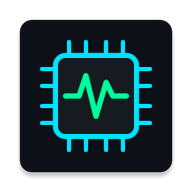
</p>

<h1 align="center">SiliconPulse</h1>

<p align="center">
  Auditoria de privacidad y telemetria de hardware para Android.<br>
  Sin internet, sin cuentas, sin anuncios. Todo se procesa en tu telefono.
</p>

<p align="center">
  <a href="https://github.com/NightmareFox12/SiliconPulse/releases/latest"></a>
  
  
  
  <a href="LICENSE"></a>
</p>

---

## Que hace

SiliconPulse responde a una pregunta sencilla: **"¿mi telefono esta haciendo algo que no deberia?"** Y, para quien quiera ir mas a fondo, expone en crudo todo lo que el hardware y el sistema reportan.

Tiene dos vistas que se cambian con un toque:

| Vista sencilla (para cualquiera)                                                                                                                                          | Vista Pro (para tecnicos)                                                                                                                                                            |
| ------------------------------------------------------------------------------------------------------------------------------------------------------------------------- | ------------------------------------------------------------------------------------------------------------------------------------------------------------------------------------ |
| Un boton **Analizar** que en segundos dice si la camara o el microfono estan en uso, si la ubicacion esta activa, si hay apps sospechosas y si el telefono descansa bien. | Osciloscopio de sensores en tiempo real, auditoria de privacidad con las APIs del sistema, radios con historial de senal, energia con monitor de deep sleep, e informes exportables. |

## Capturas

Tema claro y oscuro automatico. Todas las capturas estan en [`docs/screenshots/`](docs/screenshots/).

### Vista sencilla

| Inicio                                                         | Resultado                                                        | Enviar a IA                                                    |
| -------------------------------------------------------------- | ---------------------------------------------------------------- | -------------------------------------------------------------- |
| 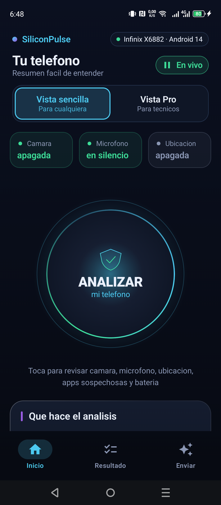  | 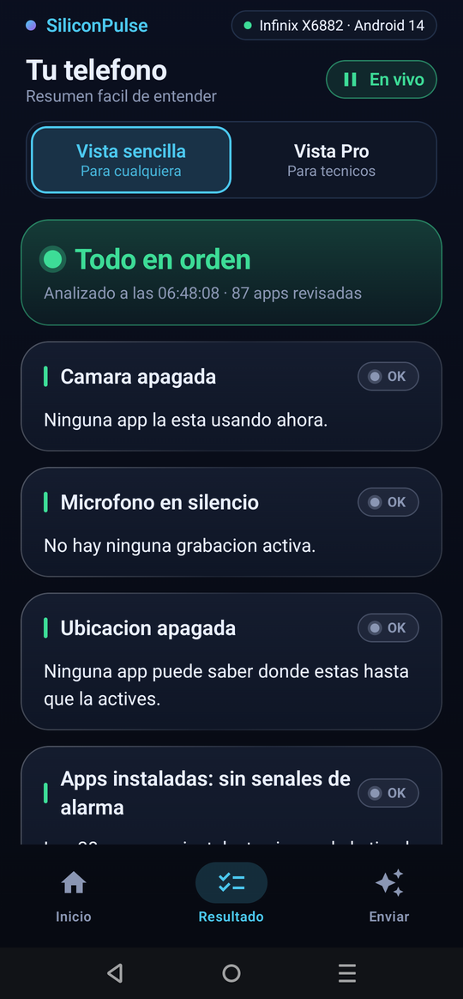  | 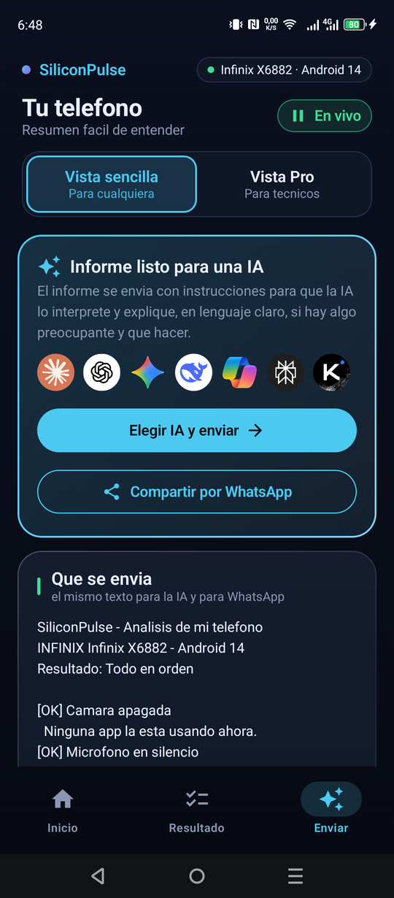  |
| 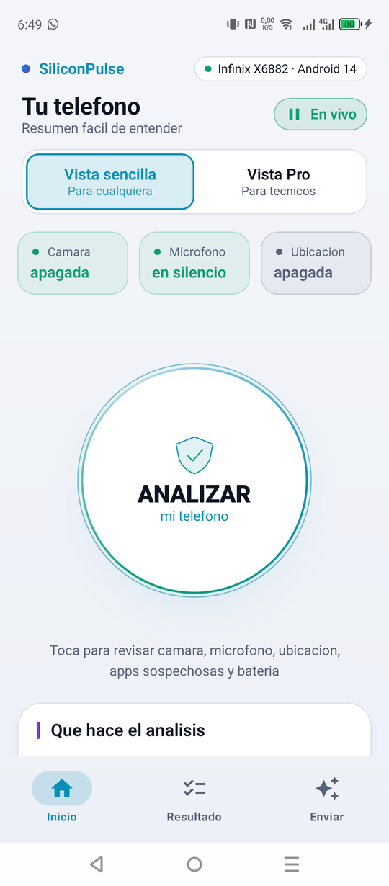 | 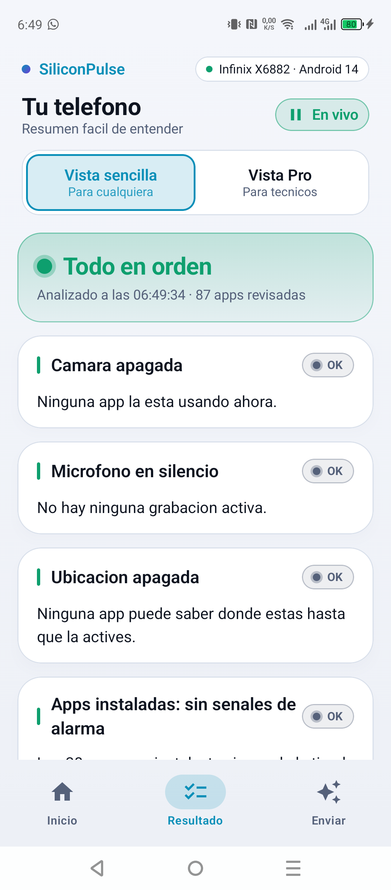 | 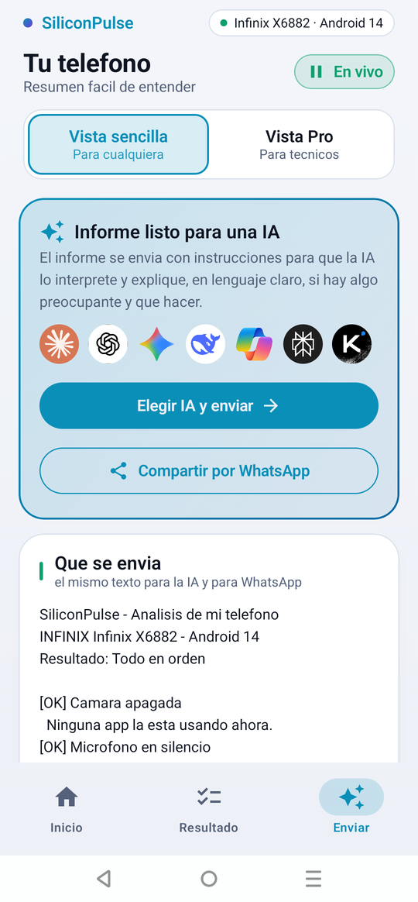 |

### Vista Pro

| Sensores                                                       | Privacidad                                                     | Radios                                                        | Energia                                                      | Informe                                                       |
| -------------------------------------------------------------- | -------------------------------------------------------------- | ------------------------------------------------------------- | ------------------------------------------------------------ | ------------------------------------------------------------- |
| 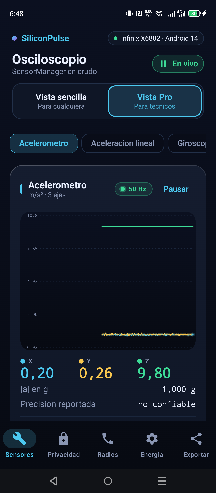  | 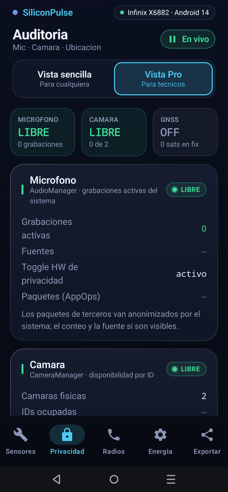  | 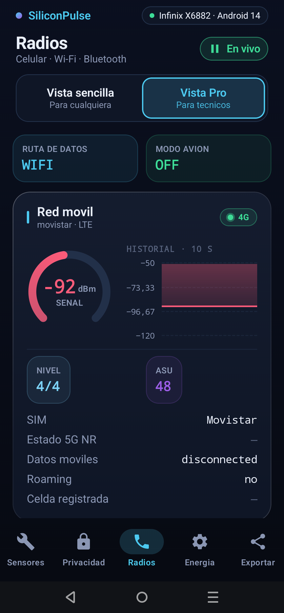  | 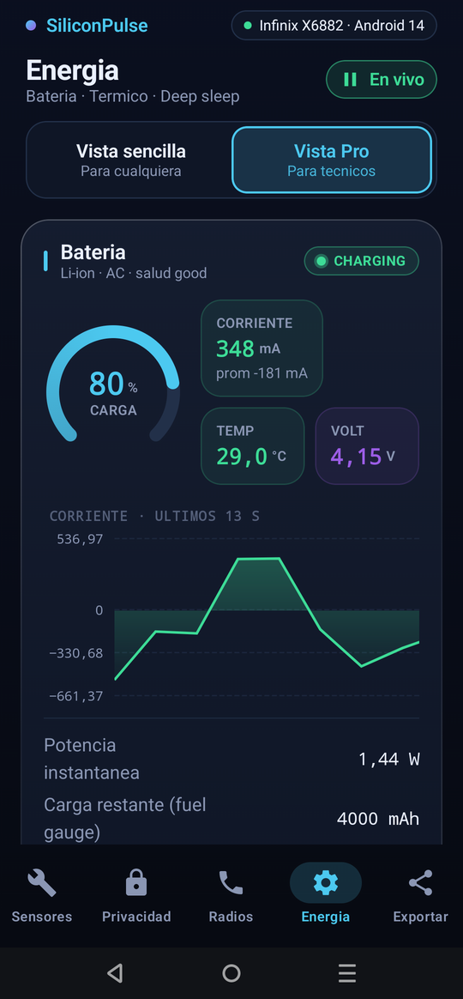  | 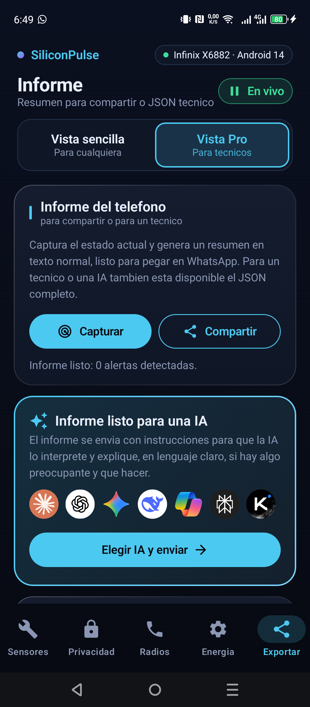  |
| 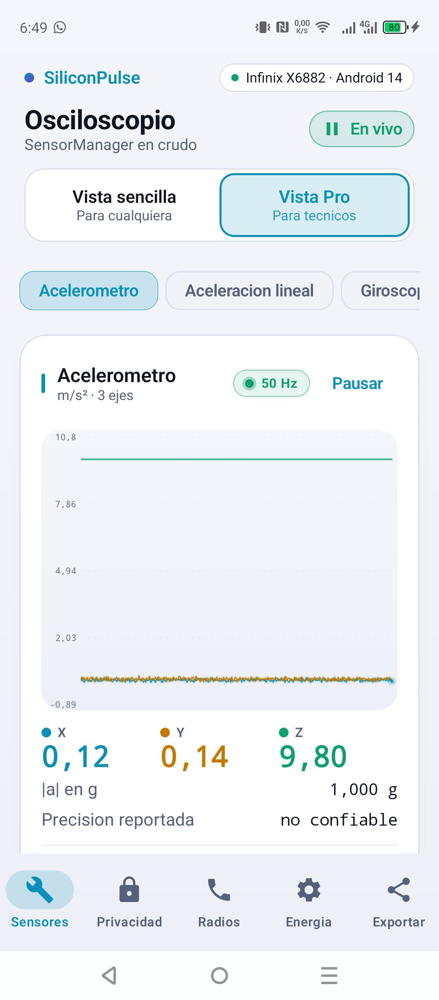 | 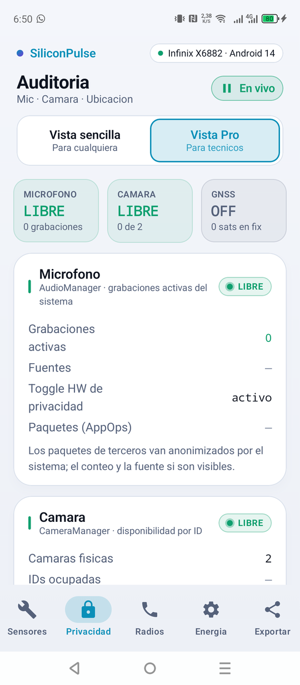 | 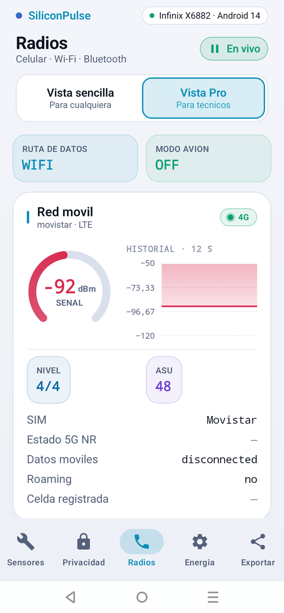 | 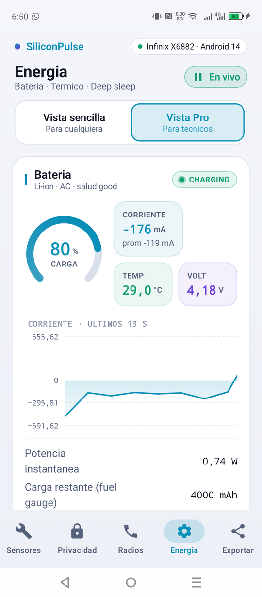 | 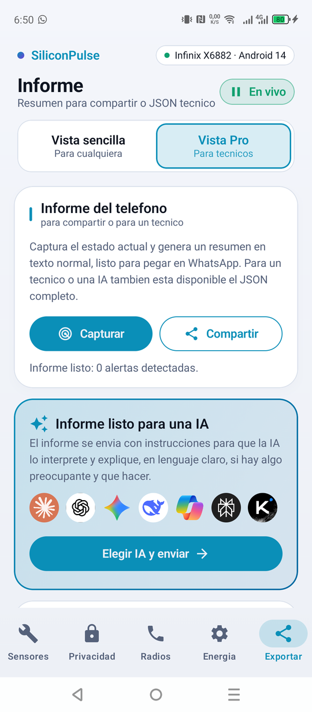 |

## Funciones

### Vista sencilla

- **Semaforo en vivo** de camara, microfono y ubicacion, visible sin pulsar nada.
- **Analisis en lenguaje claro**: veredicto general (verde, amarillo, rojo) y una tarjeta por hallazgo con que significa y que hacer.
- **Detector de apps sospechosas**: puntua cada app por origen fuera de Play Store, sin icono en el launcher, instalada hace menos de 7 dias, ubicacion "siempre", lectura de SMS, servicio de accesibilidad activo o administrador del dispositivo, siempre que ademas tenga acceso a camara, microfono, ubicacion o SMS. Desde la lista se ven los permisos o se desinstala.
- **Quien usa la camara o el micro**: con el permiso _Acceso a datos de uso_ se cruza el instante en que se ocupan con la app que estaba activa. Enlace directo al Panel de privacidad oficial de Android para confirmarlo.
- **Enviar a una IA**: prepara el analisis con instrucciones y lo manda a Claude, ChatGPT, Gemini, DeepSeek, Copilot, Perplexity o Kimi, por app o por web. Tambien se comparte por WhatsApp.

### Vista Pro

- **Sensores**: osciloscopio en Canvas de acelerometro, aceleracion lineal, giroscopio, magnetometro, luz, proximidad, barometro (con altitud estimada) y podometro. Tasa UI / Game / Fastest. Lista completa de sensores del HAL con vendor, rango, resolucion y consumo.
- **Privacidad**: grabaciones activas del sistema (AudioManager), camaras ocupadas por cualquier app (CameraManager), toggles de hardware, GNSS con satelites en fix y precision.
- **Radios**: red movil (dBm, nivel, ASU, tecnologia, estado 5G NR, celda), Wi-Fi (RSSI, banda, estandar, velocidad TX/RX, IP) y Bluetooth (vinculados, conectados, perfiles), con historico de senal.
- **Energia**: bateria (carga, corriente en mA, voltaje, temperatura, salud, ciclos), termico con headroom, frecuencia por core, memoria, y **monitor de deep sleep** que mide cuanto duerme el SoC con la pantalla apagada para detectar wakelocks.
- **Informe**: resumen en texto para WhatsApp, Markdown en tres niveles (resumen ejecutivo, tablas por componente, detalle tecnico) y JSON completo para comparar capturas o enviar a soporte.

### En general

- Tema claro y oscuro automatico segun el sistema.
- Boton **En vivo / Pausado** para congelar el monitoreo sin cerrar la app.
- Al salir de la app todo se detiene. Solo el monitor de deep sleep, si lo activas, sigue en segundo plano con una notificacion que lo deja parar.

## Descarga

APK en la seccion [Releases](https://github.com/NightmareFox12/SiliconPulse/releases). Requiere Android 11 (API 30) o superior.

Al instalar un APK fuera de Play Store, Android pedira permitir "fuentes desconocidas" para el navegador o gestor de archivos que uses.

## Permisos y por que

SiliconPulse pide solo lo que necesita para leer, nunca para enviar. No declara permiso de internet.

| Permiso                                      | Para que                                                                                     |
| -------------------------------------------- | -------------------------------------------------------------------------------------------- |
| Ubicacion                                    | SSID de la Wi-Fi, identidad de celda y satelites GNSS. Android no entrega esos datos sin el. |
| Telefono (READ_PHONE_STATE)                  | Tipo de red movil y estado del servicio.                                                     |
| Bluetooth                                    | Listar dispositivos vinculados y conectados.                                                 |
| Actividad fisica                             | Podometro por hardware.                                                                      |
| Notificaciones                               | Notificacion del monitor de deep sleep.                                                      |
| Consultar todas las apps                     | Inventario de apps y permisos para el detector de sospechosas.                               |
| Acceso a datos de uso (opcional, en Ajustes) | Saber que app estaba activa cuando se ocupo la camara o el micro.                            |

## Compilar

Requisitos: Android Studio (o solo el SDK con API 36), JDK 17 o superior.

```bash
git clone https://github.com/NightmareFox12/SiliconPulse.git
cd SiliconPulse
./gradlew assembleDebug
# APK en app/build/outputs/apk/debug/app-debug.apk
```

Stack: Kotlin, Jetpack Compose + Material 3, corrutinas y Flow, Kotlin Serialization, [Vico](https://github.com/patrykandpatrick/vico) para graficas de historico. Sin Hilt, sin Room, sin red.

### Estructura

```text
app/src/main/java/com/admin/siliconpulse/
├── domain/      modelos y contratos de repositorio
├── data/
│   ├── sensors/   SensorManager en hilo dedicado
│   ├── privacy/   AudioManager, CameraManager, AppOps, LocationManager
│   ├── radios/    Telephony, Wi-Fi, Bluetooth
│   ├── power/     BatteryManager, termico, cpufreq, SleepTracker + servicio
│   ├── audit/     inventario de apps y UsageStats
│   └── export/    texto, Markdown, JSON y destinos de IA
└── ui/
    ├── simple/    vista sencilla (Inicio, Resultado, Enviar)
    ├── oscilloscope/, privacy/, radios/, power/, export/   vista Pro
    ├── components/  tarjetas, medidores, sparklines, bloque de IA
    └── theme/     paleta clara/oscura y tipografia
```

Arquitectura MVVM con capas domain / data / ui. Cada repositorio expone un `Flow` frio que registra sus callbacks al coleccionarse y los libera al cancelarse; un interruptor global (`MonitoringController`) corta todos los flujos al salir de la app.

## Limitaciones honestas

- **Atribucion de camara y microfono**: Android no permite a una app normal preguntar que paquete tiene abierta la camara (requiere `WATCH_APPOPS`, de sistema). SiliconPulse detecta _que_ se estan usando con certeza y deduce _quien_ por correlacion temporal. La fuente definitiva es el Panel de privacidad del sistema, al que enlaza.
- **Deep sleep**: la medicion necesita el cable desconectado y la pantalla apagada unos minutos; con USB y depuracion activa el SoC no duerme.
- **Frecuencias de CPU**: algunos kernels no exponen `cpufreq` a apps de usuario.

## Hoja de ruta

- Linea de tiempo de eventos (pantalla, red, camara) para el informe.
- Aviso opcional cuando la camara o el micro se enciendan con la pantalla apagada.
- Build de release firmado y optimizado con R8.
- Traduccion al ingles.

## Licencia

[MIT](LICENSE). Usalo, modificalo y redistribuyelo libremente, manteniendo el aviso de copyright. Los logos de las IA pertenecen a sus respectivas marcas y no estan cubiertos por esta licencia.
